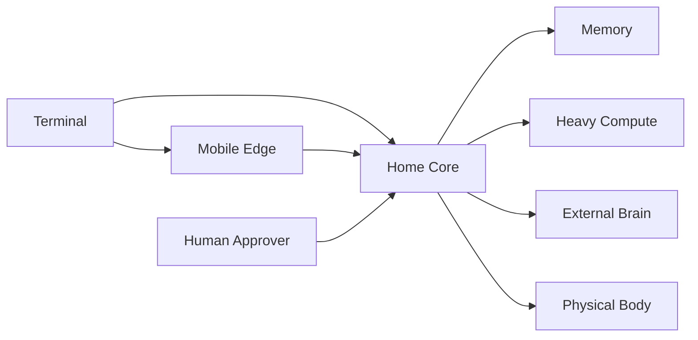

# Family Brain Architecture

A local-first, human-in-the-loop reference architecture for a family AI system that connects terminals, a home core, an optional mobile cloud edge, a private memory layer, and physical-world endpoints.

> Public edition. This repository contains architecture, patterns and safe examples only. It does not contain deployment credentials, private inventory, personal data, school data, or the private source of truth.

## Why

Most "AI assistant" designs assume a single always-on computer. A family environment is different:

- terminals change constantly;
- data is sensitive and local;
- compute is heterogeneous;
- some actions are irreversible;
- an always-on core may be at home while the user is elsewhere.

This architecture treats the system as a **hub-and-spoke organism**, not a single model:

- a **home core** is the brain and policy authority;
- a **mobile edge** can be a session carrier and digital twin;
- a **physical body** can sense and act in one room;
- a **memory layer** stores canonical artifacts;
- a **heavy compute** node handles expensive work;
- an **external brain** is used only for approved, desensitized work;
- a **human** remains the final approver.

## Layers

| Layer | Typical node | Responsibility |
|---|---|---|
| Terminal | phone, tablet, TV, browser | intent, display, approval |
| Mobile edge | portable cloud desktop | session carrier, Windows tools, relay |
| Home core | always-on mini PC | orchestration, policy, routing, audit |
| Physical body | phone / edge device | camera, microphone, sensors, UI actions |
| Memory | NAS / object store | canonical artifacts, evidence, history |
| Heavy compute | GPU workstation | vision, batch, large local models |
| External brain | approved cloud model | desensitized heavy reasoning |
| Human | owner / family / guest | approval, red lines, kill switch |



## Core ideas

### 1. Body and brain are separate

The brain does not move. A mobile edge or a terminal can be replaced without moving the brain. A physical body can be fixed in one room while a virtual body follows the user.

### 2. Hub-and-spoke, not a swarm

The home core routes work to tools. Other nodes do not negotiate with each other directly unless the core authorizes it. This keeps policy, budget and audit in one place.

### 3. SOP before autonomy

Every role has an SOP: inputs, tools, steps, validation gates, output schema, failure behavior and handoff. A model without an SOP is a demo, not a production worker.

### 4. Task and session capsules

Tasks travel as signed, scoped capsules: intent, scope, deadline, data references, permissions and expected artifact. Session state can be handed off between terminals without exposing the brain.

### 5. Single active session, explicit handoff

A mobile edge may allow only one interactive session. Design for handoff, not dual login: suspend, sync, reconnect, resume. Background agents run as services or out-of-band workers, not as a second human session.

### 6. Read-only by default

Read first. Writes are reversible by default. Irreversible actions require human approval. Root, company data, secrets export and MFA bypass are not exposed to the model.

## Loops

- **Data loop**: capture -> edge filtering -> core -> memory -> approved artifact.
- **Logic loop**: identity -> task capsule -> policy -> routing -> execution -> validation -> delivery -> audit -> revoke.
- **Mapping loop**: any terminal can be a window; role lenses and scoped capsules follow the user; canonical state stays in the core and memory.

See [docs/loops.md](docs/loops.md) for details.

## Permission model

| Level | Examples | Policy |
|---|---|---|
| L0 read-only | status, documents, inventory read | allowed by default, audited |
| L1 reversible write | reports, uploads, notifications, jobs | automatic with audit and undo |
| L2 irreversible | delete, send message, pay, network change | human approval, second confirmation, rollback plan |
| L3 forbidden | root, company data, secret export, MFA bypass | never exposed to the model |

See [docs/security.md](docs/security.md).

## Non-goals

- Not a product, not a hosted service, not a vendor endorsement.
- Not a design for unattended irreversible actions.
- Not a place for personal data, school data, credentials or private inventory.
- Not a replacement for a NAS, a backup plan or an organization's security policy.

## Repository layout

```text
.
├── README.md
├── LICENSE              # Apache-2.0, code
├── LICENSE-docs         # CC BY 4.0, documentation and diagrams
├── NOTICE
├── CHANGELOG.md
├── CITATION.cff
├── CONTRIBUTING.md
├── SECURITY.md
├── public_export.yaml   # allowlist / redaction manifest for the public edition
├── .github/
│   ├── CODEOWNERS
│   ├── PULL_REQUEST_TEMPLATE.md
│   ├── ISSUE_TEMPLATE/
│   ├── dependabot.yml
│   └── workflows/validate.yml
└── docs/
    ├── architecture.md
    ├── loops.md
    ├── roles.md
    ├── security.md
    ├── github-hardening.md
    └── publishing.md
```

## Status

Reference architecture, public edition v0.1. The private deployment and source of truth are not included. Expect evolution; interfaces and policies may change.

## License

- Code: [Apache License 2.0](LICENSE)
- Documentation and diagrams: [CC BY 4.0](LICENSE-docs)

Please retain the [NOTICE](NOTICE) and attribution when redistributing.
